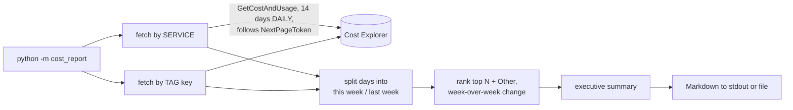

# Weekly AWS cost report from Cost Explorer

A small Python script that reads two weeks of spend from AWS Cost Explorer,
finds the top cost drivers by service and by one cost allocation tag, and
writes a short Markdown report with an executive summary at the top.

> **Status:** AWS Cost Explorer and Markdown output are implemented and
> unit tested against a hand-written fake client and JSON fixtures (32 tests,
> including error and empty-data cases). It has **not** been run against a
> real AWS account. **Azure Cost Management and PDF output are not
> implemented.**

## Problem

> Create a Python script that analyzes AWS Cost Explorer / Azure Cost
> Management data, identifies top cost drivers by service/tag, and generates
> weekly executive reports in Markdown/PDF.

Why it matters: the Cost Explorer console shows what was spent, but not what
changed this week or which team owns it. A short weekly summary of the top
drivers, by service and by a team tag, gives the people who can act on spend
something they will actually read.

This repo covers the AWS + Markdown half. Markdown converts to PDF with any
standard tool (pandoc, a browser print), so PDF was left out to keep the
code small.

## How it works



1. One `GetCostAndUsage` call per grouping covers 14 days with `DAILY`
   granularity and the `UnblendedCost` metric. Every page is read by
   following `NextPageToken`.
2. Each day is put into this week `[end-7, end)` or last week
   `[end-14, end-7)`. `end` is exclusive, the same as Cost Explorer.
3. Amounts arrive as strings and are parsed straight into `Decimal`, so
   totals are exact. Formatting rounds to cents only at the very end.
4. For the tag view, Cost Explorer returns keys like `team$web`. A key with
   an empty value (`team$`) is spend with no tag and gets its own
   `(untagged)` line.
5. The report shows top N rows per table, rolls the rest into one
   `Other (k)` row, and adds absolute and percent change. A service with no
   spend last week shows `new`.

### Example output (from the test fixtures)

```markdown
## Executive summary

- Total spend this week: **$445.64** (+$105.24, +30.9% vs last week's $340.40).
- Largest cost driver: **Amazon Elastic Compute Cloud - Compute** at $300.25 (67.4% of total).
- Biggest increase: **Amazon Elastic Compute Cloud - Compute**, +$100.05 (+50.0%).
- Spend without a `team` tag: $75.00 (16.8% of tagged-view total).
```

## Usage

```bash
python -m pip install -r requirements-dev.txt

# Run the same checks CI runs
python -m ruff check .
python -m ruff format --check .
python -m pytest -q

# Real run (needs AWS credentials with ce:GetCostAndUsage)
python -m cost_report --tag team --top 5 --output weekly.md
python -m cost_report --end 2026-11-16          # report the week before this date
```

| Flag | Default | Meaning |
|---|---|---|
| `--end` | today (UTC) | exclusive end date of the reported week |
| `--tag` | none | cost allocation tag key for the second table |
| `--top` | 5 | rows per table before the `Other` rollup |
| `--output` | stdout | file to write the Markdown to |

The only IAM permission needed is `ce:GetCostAndUsage`. The tag must be
activated as a cost allocation tag in the billing console before Cost
Explorer can group by it.

## Failure behaviour

The script fails loudly and exits `1` without writing a report when:

- the Cost Explorer API raises (access denied, throttling, bad tag key);
- the response has no `ResultsByTime`, or no cost groups at all;
- an amount is not in USD;
- a returned day falls outside the requested window.

No retries are added on top of boto3's own retry settings.

## Limits

- AWS only. Azure Cost Management is not implemented.
- Markdown only. PDF is not implemented.
- One tag key per run. Groups by `SERVICE` dimension only, not by account,
  region, or usage type.
- `UnblendedCost` only. Amortized cost, credits, and refunds are not
  separated out.
- Cost Explorer data for the most recent day or two is often incomplete and
  marked `Estimated`; the report does not flag this. Pick an `--end` a day
  or two back for stable numbers.
- Each `GetCostAndUsage` request is billed by AWS (a small per-request
  charge). A run makes at least one request per grouping, more when paged.

## Security notes

- Read-only: the only API call is `GetCostAndUsage`.
- No credentials in code or config; boto3 uses the normal credential chain.
- Cost data is sensitive business data. Treat the output file the way you
  would treat the bill.

## Idempotency

Reading cost data changes nothing, so running it twice is safe. For a fixed
`--end` date the report is the same each run, except where AWS itself
revises recent estimated numbers.

## Layout

```
cost_report/explorer.py   Cost Explorer query, pagination, Decimal parsing
cost_report/report.py     ranking, week-over-week maths, Markdown
cost_report/cli.py        argument parsing, exit codes
tests/fakes.py            fake Cost Explorer client
tests/fixtures/           canned API responses (two pages + tag view)
```
